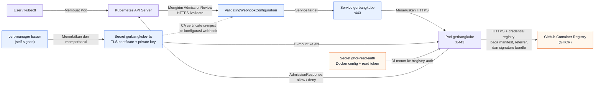

# Alur komunikasi gerbangkube

Gerbangkube memiliki dua jalur komunikasi yang berbeda:

1. Kubernetes API Server berkomunikasi dengan gerbangkube sebagai admission
   webhook melalui HTTPS.
2. Gerbangkube berkomunikasi dengan GHCR untuk membaca manifest image,
   referrer, dan bundle signature.

## Jalur Kubernetes API Server ke gerbangkube

Gerbangkube berfungsi sebagai `ValidatingWebhook`. Saat Kubernetes API Server
menerima request pembuatan Pod, API Server mengirimkan `AdmissionReview` ke
endpoint `/validate` melalui Service gerbangkube.

cert-manager membuat sertifikat TLS melalui `Issuer`, lalu menyimpannya di
Secret `gerbangkube-tls`. Secret tersebut di-mount ke Pod gerbangkube sehingga
server webhook dapat melayani koneksi HTTPS.

cert-manager juga meng-inject CA certificate ke
`ValidatingWebhookConfiguration`. Hal ini membuat API Server dapat memverifikasi
bahwa sertifikat yang digunakan gerbangkube dipercaya. Jalur ini adalah fungsi
cert-manager.

Setelah memeriksa image dan signature, gerbangkube mengirimkan
`AdmissionResponse` ke API Server untuk mengizinkan atau menolak Pod.

## Jalur gerbangkube ke GHCR

Saat memeriksa image, gerbangkube perlu membaca informasi image dan signature
dari GHCR. Credential untuk registry disimpan dalam Secret
`ghcr-read-auth`, lalu di-mount ke Pod pada `/registry-auth`.

Gerbangkube menggunakan credential tersebut untuk melakukan request HTTPS ke
GHCR. Pada jalur ini, autentikasi dilakukan menggunakan credential registry
yang berasal dari token GitHub dengan hak baca package, bukan menggunakan
cert-manager.

## Perbedaan komponen

| Komponen | Fungsi | Jalur |
| --- | --- | --- |
| cert-manager | Membuat dan mengelola sertifikat TLS webhook | API Server → gerbangkube |
| `gerbangkube-tls` | Menyimpan sertifikat dan private key webhook | API Server → gerbangkube |
| `ghcr-read-auth` | Menyimpan konfigurasi Docker dan credential read-only GHCR | gerbangkube → GHCR |
| Token GitHub | Mengautentikasi gerbangkube ke GHCR | gerbangkube → GHCR |
| gerbangkube | Memvalidasi signature image dan memberi keputusan admission | Kedua jalur |

**Kesimpulan:** cert-manager tidak membantu gerbangkube login atau mengambil
image dari GHCR. cert-manager mengamankan koneksi webhook Kubernetes, sedangkan
token GitHub yang disimpan dalam `ghcr-read-auth` mengizinkan gerbangkube
membaca data dari GHCR.
